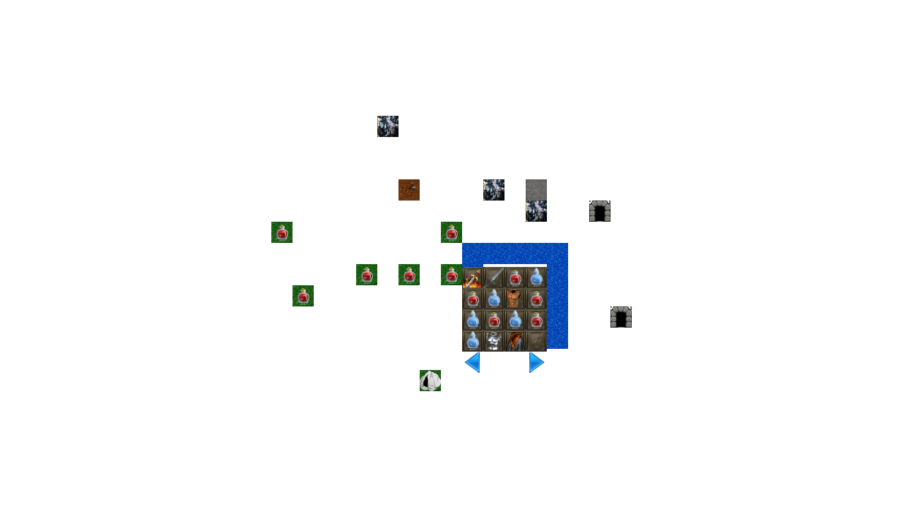

# Recovered game snapshot

Original commit: `c577f6225739c5e3e1cf90081a92e997eaed65a4`. Original tree: `ee1adf0173187c0be99237bcc4fdeb2fc3ff68bc`.
Startup was verified from identical recovered sources at `c577f6225739c5e3e1cf90081a92e997eaed65a4`.

This recovered version compiled and linked on Linux, started the real game on an isolated Xvfb display,
loaded its map and a healthy player, rendered the screenshot below, and exited normally.

The Linux build copy reads console commands through Qt’s stdin notifier so the game can exit.



## Build and run

Install Qt 5 Core, Gui and Widgets development files and a C++ compiler, with CPython 3.4 development files and its matching Boost.Python library. The verified tool versions were:

- g++-5 (Ubuntu 5.4.0-6ubuntu1~16.04.12) 5.4.0 20160609
- QMake version 3.0
- Using Qt version 5.5.1 in /usr/lib/x86_64-linux-gnu

Build from this snapshot's root directory:

```sh
python3 recovery/prepare_console_reader.py
qmake Game.pro QMAKE_CC=gcc-5 QMAKE_CXX=g++-5 QMAKE_LINK=g++-5 'QMAKE_CXXFLAGS+=-include functional' -after TARGET=RecoveryGame DESTDIR=.
make -j"$(nproc)"
./RecoveryGame
```

For an isolated launch, use:

```sh
LIBGL_ALWAYS_SOFTWARE=1 QT_OPENGL=software xvfb-run -a --server-args="-screen 0 1920x1080x24" ./RecoveryGame
```

The automated readiness observer used for verification is recorded in the attached evidence; ordinary
launches run the game's original entry point. Startup evidence does not establish full gameplay equivalence.

## Recovery provenance

compatibilityRepair: 1, exactOriginal: 65, reconstruction: 46.

- `Game.pro`: content reconstruction of the BFG-removed original; qmake project regenerated with 67 sources inferred without a surviving object_script listing: reconstructed e00a7c3e:Game.pro SOURCES reconciled with this tree's files; settings from reconstructed e00a7c3e:Game.pro
- `lib/base64/base64.cpp`: unverified donor reconstruction; 779fb803ff021de5e74ed3b24d7c31a9adcaa236:base64/base64.cpp; headerMatch=0; apiOverlap=10000/10000; distance=27
- `lib/json/json_batchallocator.h`: unverified upstream reconstruction; https://github.com/open-source-parsers/jsoncpp/tree/4fce396c9d3e27a8ab8fb88e94c1676e021ae3a6; adapted json include prefix to historical lib/json layout
- `lib/json/json_reader.cpp`: unverified upstream reconstruction; https://github.com/open-source-parsers/jsoncpp/tree/4fce396c9d3e27a8ab8fb88e94c1676e021ae3a6; adapted json include prefix to historical lib/json layout
- `lib/json/json_value.cpp`: unverified upstream reconstruction; https://github.com/open-source-parsers/jsoncpp/tree/4fce396c9d3e27a8ab8fb88e94c1676e021ae3a6; adapted json include prefix to historical lib/json layout
- `lib/json/json_writer.cpp`: unverified upstream reconstruction; https://github.com/open-source-parsers/jsoncpp/tree/4fce396c9d3e27a8ab8fb88e94c1676e021ae3a6; adapted json include prefix to historical lib/json layout
- `lib/json/reader.h`: unverified upstream reconstruction; https://github.com/open-source-parsers/jsoncpp/tree/4fce396c9d3e27a8ab8fb88e94c1676e021ae3a6; adapted json include prefix to historical lib/json layout
- `lib/json/value.h`: unverified upstream reconstruction; https://github.com/open-source-parsers/jsoncpp/tree/4fce396c9d3e27a8ab8fb88e94c1676e021ae3a6; adapted json include prefix to historical lib/json layout
- `lib/json/writer.h`: unverified upstream reconstruction; https://github.com/open-source-parsers/jsoncpp/tree/4fce396c9d3e27a8ab8fb88e94c1676e021ae3a6; adapted json include prefix to historical lib/json layout
- `lib/tinyxml/tinystr.h`: unverified upstream reconstruction; https://github.com/tamatias/tmxparser/tree/6fa4d38742313b6365df0d224b8978be1eb81290
- `lib/tinyxml/tinyxml.cpp`: unverified upstream reconstruction; https://github.com/tamatias/tmxparser/tree/6fa4d38742313b6365df0d224b8978be1eb81290
- `lib/tinyxml/tinyxml.h`: unverified upstream reconstruction; https://github.com/tamatias/tmxparser/tree/6fa4d38742313b6365df0d224b8978be1eb81290
- `lib/tinyxml/tinyxmlparser.cpp`: unverified upstream reconstruction; https://github.com/tamatias/tmxparser/tree/6fa4d38742313b6365df0d224b8978be1eb81290
- `lib/tmx/TmxLayer.cpp`: unverified upstream reconstruction; https://github.com/tamatias/tmxparser/tree/6fa4d38742313b6365df0d224b8978be1eb81290; adapted vendored tinyxml/zlib include paths to historical directory layout
- `lib/tmx/TmxLayer.h`: unverified upstream reconstruction; https://github.com/tamatias/tmxparser/tree/6fa4d38742313b6365df0d224b8978be1eb81290; adapted vendored tinyxml/zlib include paths to historical directory layout
- `lib/tmx/TmxMap.cpp`: unverified upstream reconstruction; https://github.com/tamatias/tmxparser/tree/6fa4d38742313b6365df0d224b8978be1eb81290; adapted vendored tinyxml/zlib include paths to historical directory layout
- `lib/tmx/TmxMap.h`: unverified upstream reconstruction; https://github.com/tamatias/tmxparser/tree/6fa4d38742313b6365df0d224b8978be1eb81290; adapted vendored tinyxml/zlib include paths to historical directory layout
- `lib/tmx/TmxObject.cpp`: unverified donor reconstruction; 181f31e1e9a7f3516c7fbd3d4400aa0822c1d387:lib/tmx/TmxObject.cpp; headerMatch=0; apiOverlap=10000/10000; distance=31
- `lib/tmx/TmxTileset.cpp`: unverified upstream reconstruction; https://github.com/tamatias/tmxparser/tree/6fa4d38742313b6365df0d224b8978be1eb81290; adapted vendored tinyxml/zlib include paths to historical directory layout
- `lib/zlib/adler32.c`: Unmodified official zlib v1.2.5 adler32.c; Git blob verified against official tag tree 9712272c78b9d9c93746d9c8e156a3728c65ca72. Coherent same-version donor replaces mixed1.2.5/1.2.5 fallback; exact original only when originalHashMatches=true.
- `lib/zlib/crc32.c`: Unmodified official zlib v1.2.5 crc32.c; Git blob verified against official tag tree 9712272c78b9d9c93746d9c8e156a3728c65ca72. Coherent same-version donor replaces mixed1.2.5/1.2.5 fallback; exact original only when originalHashMatches=true.
- `lib/zlib/deflate.c`: Unmodified official zlib v1.2.5 deflate.c; Git blob verified against official tag tree 9712272c78b9d9c93746d9c8e156a3728c65ca72. Coherent same-version donor replaces mixed1.2.5/1.2.5 fallback; exact original only when originalHashMatches=true.
- `lib/zlib/deflate.h`: Unmodified official zlib v1.2.5 deflate.h; Git blob verified against official tag tree 9712272c78b9d9c93746d9c8e156a3728c65ca72. Coherent same-version donor replaces mixed1.2.5/1.2.5 fallback; exact original only when originalHashMatches=true.
- `lib/zlib/gzlib.c`: Unmodified official zlib v1.2.5 gzlib.c; Git blob verified against official tag tree 9712272c78b9d9c93746d9c8e156a3728c65ca72. Coherent same-version donor replaces mixed1.2.5/1.2.5 fallback; exact original only when originalHashMatches=true.
- `lib/zlib/gzread.c`: Unmodified official zlib v1.2.5 gzread.c; Git blob verified against official tag tree 9712272c78b9d9c93746d9c8e156a3728c65ca72. Coherent same-version donor replaces mixed1.2.5/1.2.5 fallback; exact original only when originalHashMatches=true.
- `lib/zlib/gzwrite.c`: Unmodified official zlib v1.2.5 gzwrite.c; Git blob verified against official tag tree 9712272c78b9d9c93746d9c8e156a3728c65ca72. Coherent same-version donor replaces mixed1.2.5/1.2.5 fallback; exact original only when originalHashMatches=true.
- `lib/zlib/infback.c`: Unmodified official zlib v1.2.5 infback.c; Git blob verified against official tag tree 9712272c78b9d9c93746d9c8e156a3728c65ca72. Coherent same-version donor replaces mixed1.2.5/1.2.5 fallback; exact original only when originalHashMatches=true.
- `lib/zlib/inffast.c`: Unmodified official zlib v1.2.5 inffast.c; Git blob verified against official tag tree 9712272c78b9d9c93746d9c8e156a3728c65ca72. Coherent same-version donor replaces mixed1.2.5/1.2.5 fallback; exact original only when originalHashMatches=true.
- `lib/zlib/inflate.c`: Unmodified official zlib v1.2.5 inflate.c; Git blob verified against official tag tree 9712272c78b9d9c93746d9c8e156a3728c65ca72. Coherent same-version donor replaces mixed1.2.5/1.2.5 fallback; exact original only when originalHashMatches=true.
- `lib/zlib/inftrees.c`: Unmodified official zlib v1.2.5 inftrees.c; Git blob verified against official tag tree 9712272c78b9d9c93746d9c8e156a3728c65ca72. Coherent same-version donor replaces mixed1.2.5/1.2.5 fallback; exact original only when originalHashMatches=true.
- `lib/zlib/trees.c`: Unmodified official zlib v1.2.5 trees.c; Git blob verified against official tag tree 9712272c78b9d9c93746d9c8e156a3728c65ca72. Coherent same-version donor replaces mixed1.2.5/1.2.5 fallback; exact original only when originalHashMatches=true.
- `lib/zlib/zlib.h`: Unmodified official zlib v1.2.5 zlib.h; Git blob verified against official tag tree 9712272c78b9d9c93746d9c8e156a3728c65ca72. Coherent same-version donor replaces mixed1.2.5/1.2.5 fallback; exact original only when originalHashMatches=true.
- `lib/zlib/zutil.c`: Unmodified official zlib v1.2.5 zutil.c; Git blob verified against official tag tree 9712272c78b9d9c93746d9c8e156a3728c65ca72. Coherent same-version donor replaces mixed1.2.5/1.2.5 fallback; exact original only when originalHashMatches=true.
- `lib/zlib/zutil.h`: Unmodified official zlib v1.2.5 zutil.h; Git blob verified against official tag tree 9712272c78b9d9c93746d9c8e156a3728c65ca72. Coherent same-version donor replaces mixed1.2.5/1.2.5 fallback; exact original only when originalHashMatches=true.
- `res/config/map.tmx`: unverified donor reconstruction; authored Tiled geometry/object coordinates from 55e6516e:maps/map1/map.json converted to XML; missing target script reference omitted
- `res/config/object.json`: unverified donor reconstruction; split object descriptors e8b7c3d0e6da989122a0587943a98504342da3cd:config/objects flattened to observed legacy class/path API; target tile/interaction entries preserved; species stats retain uncertainty of reconstructed creatures catalog
- `res/images/loading.png`: synthesized visible 32px placeholder; original artwork unavailable; unverified
- `src/creature.cpp`: content reconstruction of the BFG-removed original; carried from the #203 reconstruction; isAlive and getGold lose const and plain accessors setMana/setManaMax/getManaRegRate/setManaRegRate/setHp/setHpMax are inferred for the USER Q_PROPERTYs declared in #204
- `src/gamescene.cpp`: content reconstruction of the BFG-removed original; carried forward unchanged from the surviving original src/gamescene.cpp at e00a7c3e (previous version of src/gamescene.cpp)
- `src/gamescript.cpp`: content reconstruction of the BFG-removed original; carried forward unchanged from the reconstruction a1f41460b8 (previous version of src/gamescript.cpp)
- `src/gameview.cpp`: content reconstruction of the BFG-removed original; carried forward unchanged from the reconstruction adcbe3a18c (previous version of src/gameview.cpp)
- `src/interaction.cpp`: Missing body adapted from accepted #150 std::string native action/effect reconstruction to exact #195 default/copy/load-by-name API, typeName and consolidated config. Retains all native action/effect bodies; removes only save methods absent from surviving class declarations. Not exact source or gameplay parity. Inputs: [{"path": "/tmp/nouraajd-bfg-recovery/source/recovery/payloads/reconstructions/0b/0b0a9c19112914c23dcd4a6e2e032f335f7abf76-interaction.cpp", "sha256": "58c845dc10998af9d2593755795e2cbfce4f8fdd9e05369db918e2212cc511ec"}, {"path": "src/interaction.h", "sha256": "10c5b800cf7fa1d21c48f7b8d546fb337322e4c7bb75cb5418ace80b51b61b7b"}]
- `src/map.cpp`: content reconstruction of the BFG-removed original; carried from the #203 reconstruction; Map::isEditor removed with its declaration, so map objects no longer take editor mouse presses
- `src/pathfinder.cpp`: Missing #197 merged pathfinder preserves exact older original base/dumb/random/smart algorithms from native #195/196 cohort, adapting only worker signal names and genuine new CompletionListener API. Constructor counts queued workers before main turn ends; completed movement arrives before ended/deregister; final worker emits Map completion once. Singleton static initialization zeroes genuine workers/started fields. No fabricated completion result, no omitted AI; inferred worker body, not parity. Inputs: [{"path": "/tmp/nouraajd-bfg-recovery/native-upper-middle/recon/a66abb977d8290f3e46b61e4b2a9708a87ba6630", "sha256": "ccfeaa238eeb5a20f078ae42af8642001f597c8c62d96392f1feac8361dd8a38"}, {"path": "src/pathfinder.h", "sha256": "5176d4852a684c173bea481e2027b407d7fb3d224ad65806a1227a326c5d0c10"}]
- `src/stats.cpp`: content reconstruction of the BFG-removed original; carried forward unchanged from the reconstruction 5170bfc60a (previous version of src/stats.cpp)
- `src/stats.h`: content reconstruction of the BFG-removed original; seeded from the surviving #203 stats.h; #204 (stats properties) registers Stats and Damage as Qt metatypes in its surviving main.cpp, so Q_DECLARE_METATYPE(Stats) and Q_DECLARE_METATYPE(Damage) are inferred
- `lib/json/LICENSE`: https://github.com/open-source-parsers/jsoncpp/tree/4fce396c9d3e27a8ab8fb88e94c1676e021ae3a6 upstream distribution license

Restored source fingerprint: `279cd32c597c4488db955b2aef037b1fb0cdf93fa8296dca81fd9859f7b0da92`.

The restored source fingerprint identifies inputs before generation. The
[source preparation metadata](recovery/source-preparation.json) records the original inputs
and every generated or modified file's before/after hashes; the
[preparation log](recovery/source-preparation.log) retains the actual preparation steps.

The actual 1278 × 718 screenshot and [verification metadata](recovery/verification.json) belong to
this source version. Reconstructed code and borrowed assets are identified in that metadata; they are
not claimed to be the original deleted bytes. BFG removal-marker files are absent from this snapshot.
