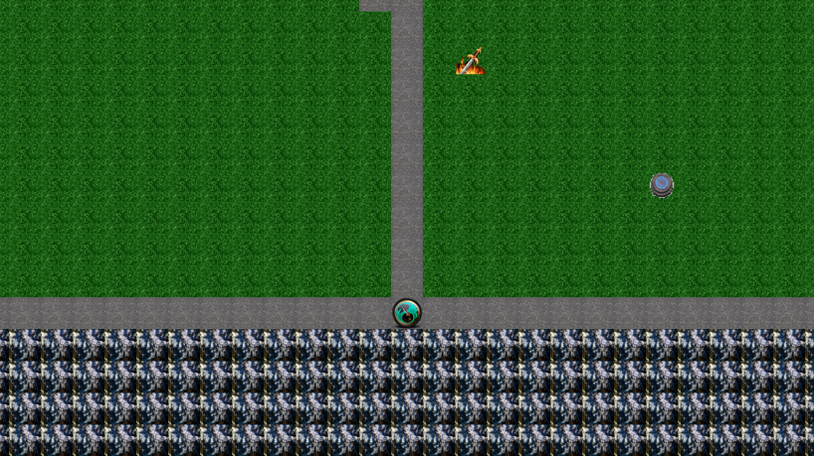

# Recovered game snapshot

Original commit: `937210731327bd6202a04e67dfd471508f65894a`. Original tree: `9118081935f3720147cc6191cddc7eabf8ea0ec3`.
Startup was verified from identical recovered sources at `937210731327bd6202a04e67dfd471508f65894a`.

This recovered version compiled and linked on Linux, started the real game on an isolated Xvfb display,
loaded its map and a healthy player, rendered the screenshot below, and exited normally.



## Build and run

Install Qt 5 Core, Gui and Widgets development files and a C++ compiler. The verified tool versions were:

- g++ (Ubuntu 15.2.0-16ubuntu1) 15.2.0
- QMake version 3.1
- Using Qt version 5.15.18 in /tmp/nouraajd-recovery-qt/root/usr/lib/x86_64-linux-gnu

Build from this snapshot's root directory:

```sh
qmake Game.pro -after TARGET=RecoveryGame DESTDIR=.
make -j"$(nproc)"
./RecoveryGame
```

For an isolated launch, use:

```sh
LIBGL_ALWAYS_SOFTWARE=1 QT_OPENGL=software xvfb-run -a --server-args="-screen 0 1920x1080x24" ./RecoveryGame
```

The automated readiness observer used for verification is recorded in the attached evidence; ordinary
launches run the game's original entry point. Startup evidence does not establish full gameplay equivalence.

## Recovery provenance

compatibilityRepair: 12, exactOriginal: 25, reconstruction: 18.

- `Game.pro`: unverified donor reconstruction; 108bdcbeda04cefeba5e1895f91df023cea8487f:Game.pro; headerMatch=0; apiOverlap=0/10000; distance=4
- `creatures/creature.cpp`: Reviewedpre-JSON2013 transition: preserve pointerStats butvalueactions/effects, originalactorstats and mapcontainer; functionalcallbacks/getters reconstructed against exacttargetheaders. Build/startup pending.
- `images/buildings/cave/0.png`: unverified donor reconstruction; 71a3432e36b5649aabdd63c7807a78e9a8a3749a:images/buildings/cave/0.png; headerMatch=0; apiOverlap=0/10000; distance=157
- `images/tiles/grass/0.png`: unverified donor reconstruction; c049ac73064442354af6224d06fe1c8b847bb8d9:images/tiles/grass/0.png; headerMatch=0; apiOverlap=0/10000; distance=103
- `images/tiles/ground/0.png`: unverified donor reconstruction; c049ac73064442354af6224d06fe1c8b847bb8d9:images/tiles/ground/0.png; headerMatch=0; apiOverlap=0/10000; distance=103
- `images/tiles/mountain/0.png`: unverified donor reconstruction; 152007b28631784d3c5e17f2686eb6ef9ff30e46:images/tiles/mountain/0.png; headerMatch=0; apiOverlap=0/10000; distance=153
- `images/tiles/road/0.png`: unverified donor reconstruction; 152007b28631784d3c5e17f2686eb6ef9ff30e46:images/tiles/road/0.png; headerMatch=0; apiOverlap=0/10000; distance=153
- `images/tiles/water/0.png`: unverified donor reconstruction; c049ac73064442354af6224d06fe1c8b847bb8d9:images/tiles/water/0.png; headerMatch=0; apiOverlap=0/10000; distance=103
- `json/json_batchallocator.h`: unverified upstream reconstruction; https://github.com/open-source-parsers/jsoncpp/tree/4fce396c9d3e27a8ab8fb88e94c1676e021ae3a6
- `json/json_reader.cpp`: unverified upstream reconstruction; https://github.com/open-source-parsers/jsoncpp/tree/4fce396c9d3e27a8ab8fb88e94c1676e021ae3a6
- `json/json_value.cpp`: unverified upstream reconstruction; https://github.com/open-source-parsers/jsoncpp/tree/4fce396c9d3e27a8ab8fb88e94c1676e021ae3a6
- `json/json_writer.cpp`: unverified upstream reconstruction; https://github.com/open-source-parsers/jsoncpp/tree/4fce396c9d3e27a8ab8fb88e94c1676e021ae3a6
- `json/reader.h`: unverified upstream reconstruction; https://github.com/open-source-parsers/jsoncpp/tree/4fce396c9d3e27a8ab8fb88e94c1676e021ae3a6
- `json/value.h`: unverified upstream reconstruction; https://github.com/open-source-parsers/jsoncpp/tree/4fce396c9d3e27a8ab8fb88e94c1676e021ae3a6
- `json/writer.h`: unverified upstream reconstruction; https://github.com/open-source-parsers/jsoncpp/tree/4fce396c9d3e27a8ab8fb88e94c1676e021ae3a6
- `map/map.cpp`: unverified donor reconstruction; 108bdcbeda04cefeba5e1895f91df023cea8487f:map/map.cpp; headerMatch=0; apiOverlap=9500/10000; distance=4
- `stats/stats.cpp`: unverified donor reconstruction; 108bdcbeda04cefeba5e1895f91df023cea8487f:stats/stats.cpp; headerMatch=1; apiOverlap=10000/10000; distance=4
- `view/gamescene.cpp`: unverified donor reconstruction; 108bdcbeda04cefeba5e1895f91df023cea8487f:view/gamescene.cpp; headerMatch=1; apiOverlap=10000/10000; distance=4
- `animation/animatedobject.h`: Reviewedpre-JSON2013 transition: preserve pointerStats butvalueactions/effects, originalactorstats and mapcontainer; functionalcallbacks/getters reconstructed against exacttargetheaders. Build/startup pending.
- `animation/animationprovider.cpp`: Reviewedpre-JSON2013 transition: preserve pointerStats butvalueactions/effects, originalactorstats and mapcontainer; functionalcallbacks/getters reconstructed against exacttargetheaders. Build/startup pending.
- `creatures/monsters/pritz.cpp`: Reviewedpre-JSON2013 transition: preserve pointerStats butvalueactions/effects, originalactorstats and mapcontainer; functionalcallbacks/getters reconstructed against exacttargetheaders. Build/startup pending.
- `creatures/monsters/pritzmage.cpp`: Reviewedpre-JSON2013 transition: preserve pointerStats butvalueactions/effects, originalactorstats and mapcontainer; functionalcallbacks/getters reconstructed against exacttargetheaders. Build/startup pending.
- `creatures/players/mage.cpp`: Reviewedpre-JSON2013 transition: preserve pointerStats butvalueactions/effects, originalactorstats and mapcontainer; functionalcallbacks/getters reconstructed against exacttargetheaders. Build/startup pending.
- `creatures/players/player.cpp`: Reviewedpre-JSON2013 transition: preserve pointerStats butvalueactions/effects, originalactorstats and mapcontainer; functionalcallbacks/getters reconstructed against exacttargetheaders. Build/startup pending.
- `creatures/players/rogue.cpp`: Reviewedpre-JSON2013 transition: preserve pointerStats butvalueactions/effects, originalactorstats and mapcontainer; functionalcallbacks/getters reconstructed against exacttargetheaders. Build/startup pending.
- `creatures/players/warrior.cpp`: Reviewedpre-JSON2013 transition: preserve pointerStats butvalueactions/effects, originalactorstats and mapcontainer; functionalcallbacks/getters reconstructed against exacttargetheaders. Build/startup pending.
- `json/LICENSE`: https://github.com/open-source-parsers/jsoncpp/tree/4fce396c9d3e27a8ab8fb88e94c1676e021ae3a6 upstream distribution license
- `map/map.h`: Reviewedpre-JSON2013 transition: preserve pointerStats butvalueactions/effects, originalactorstats and mapcontainer; functionalcallbacks/getters reconstructed against exacttargetheaders. Build/startup pending.
- `map/tiles/tile.h`: Reviewedpre-JSON2013 transition: preserve pointerStats butvalueactions/effects, originalactorstats and mapcontainer; functionalcallbacks/getters reconstructed against exacttargetheaders. Build/startup pending.
- `view/gameview.cpp`: Reviewedpre-JSON2013 transition: preserve pointerStats butvalueactions/effects, originalactorstats and mapcontainer; functionalcallbacks/getters reconstructed against exacttargetheaders. Build/startup pending.

Restored source fingerprint: `68553ab36f6febf30bd7379391a942af086d05faf5f0919cba50e5794f86a00e`.

The actual 1278 × 718 screenshot and [verification metadata](recovery/verification.json) belong to
this source version. Reconstructed code and borrowed assets are identified in that metadata; they are
not claimed to be the original deleted bytes. BFG removal-marker files are absent from this snapshot.
